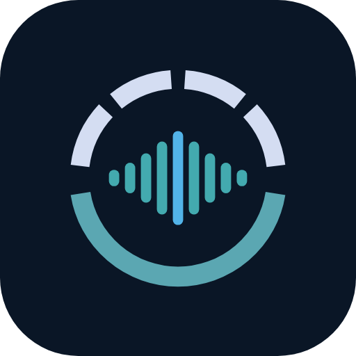
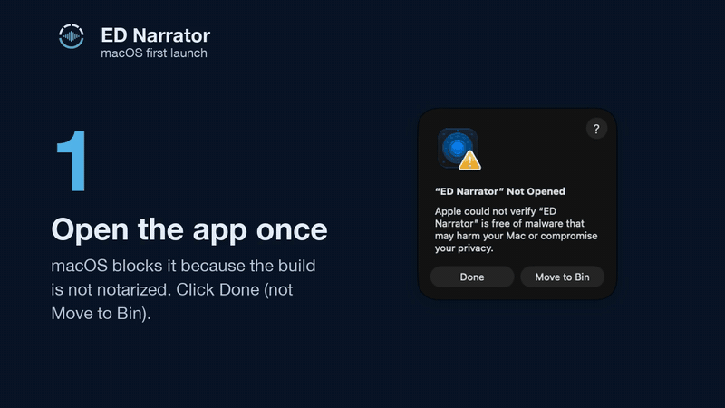

<p align="center"></p>

<h1 align="center">ED Narrator</h1>

<p align="center"><b>Voice-overs, timed to your film.</b><br>
A product of <a href="https://www.emerton-data.com/">Emerton Data</a>.</p>

Upload a film (`.mp4`) and a script (`.srt`, `.md` or `.txt`), pick a voice, and get the same film back with the new narration timed to your subtitles. Everything runs on your computer.

This repository hosts desktop installers and the public Claude Code and Cowork plugin marketplace. It is where the app downloads its updates from.

## Download

**[Get the latest release](https://github.com/EmertonData/ed-narrator-releases/releases/latest)** and take the file for your system:

| System | File | Status |
|---|---|---|
| **macOS** (Apple silicon: M1 and later) | `ED-Narrator_<version>_aarch64.dmg` | available |
| **macOS** (Intel) | none yet | not available |
| **Windows** | `ED-Narrator_<version>_x64-setup.exe` | not in every release yet |
| **Linux** | `ED-Narrator_<version>_amd64.AppImage` | not in every release yet |

The release page lists exactly the files it carries.

<!-- ed-narrator-marketplace:start -->
## Claude Code and Cowork

The **ED Narrator Studio** plugin captures an app or uses an existing film, adds motion design, voices it, and mixes optional music. Install it from this public marketplace:

```bash
claude plugin marketplace add EmertonData/ed-narrator-releases
claude plugin install ed-narrator-studio@ed-narrator-public
```

In Cowork, choose **Customize > Plugins > Add > Add marketplace**, enter `EmertonData/ed-narrator-releases`, then add **ED Narrator Studio**. The Releases page also has a plugin ZIP for direct upload and a standalone voice-over skill ZIP; the standalone skill needs the MCP connector configured separately.

Try `/ed-narrator-studio:studio a 40 second demo of <your app>` for the full studio workflow, or `/ed-narrator-studio:ed-narrator-voiceover` for voice-over only. You can also describe the task in plain language.

### App setup and supported files

- Keep ED Narrator running on the same computer. The desktop app uses `http://127.0.0.1:18090` by default; Docker uses `http://127.0.0.1:8090`. Claude Code can change `ED_NARRATOR_URL` in the plugin's `/config` settings. Keep the address on loopback: the app has no login.
- The plugin needs `uv` to start the public MCP connector. Cowork's local connector works in a local Cowork session in the desktop app.
- The safe defaults read media from `~/Movies` and save results to `~/Movies/ed-narrator-output`. Claude Code users can change `ED_NARRATOR_INPUT_DIRS` and `ED_NARRATOR_OUTPUT_DIR` in `/config`; keep inputs in dedicated folders, not your home folder.
- Supported films: `.mp4`, `.m4v`, `.mov`; scripts: `.srt`, `.md`, `.markdown`, `.txt`; optional music: `.mp3`, `.wav`, `.m4a`, `.aac`, `.ogg`, `.flac`.
- Install a voice in the app's **Models** panel before starting. The plugin cannot read the Azure key; add or manage it in the app's **Settings**.

See the [installation and safety guide](docs/claude-plugins.md) and [studio plugin guide](plugin/ed-narrator-studio/README.md).
<!-- ed-narrator-marketplace:end -->

## Install on macOS

Open the DMG and drag **ED Narrator** to *Applications*. The first time, macOS blocks it, because the app is not signed with an Apple Developer ID. It is expected, and you allow it once:

<p align="center"></p>

1. **Open the app once** and let macOS block it. Click **Done** (not *Move to Bin*).
2. Open **System Settings > Privacy & Security**, scroll down to the line about "ED Narrator" and click **Open Anyway**. Confirm with your password or Touch ID.
3. **Open the app again** and click **Open**. From now on it starts normally.

On macOS 14 and older, right-click the app and choose *Open* instead. On any version you can also run this once in the Terminal: `xattr -cr "/Applications/ED Narrator.app"`.

## First voice-over

1. Open the app. A short tour explains the steps (reopen it with **Tour** in the left bar).
2. Open **Models** and install a Piper voice (about 65 MB, needs internet once). Voices are downloaded and kept on your computer.
3. Drop a film and a script, pick the voice, and press **Voice the film**.
4. Compare the original and the new audio, then download the MP4, MP3, WAV or SRT.

## Updates

From version 1.3.0 the app updates itself. At start (once a day) and from **Help > Check for updates** it asks this repository for `latest.json`. When a newer version exists it offers **Install and restart**. The download is checked against a signature before it is installed, and your voices, settings and results are kept. Only the version request leaves your computer.

Version 1.2.0 and older have no updater: install the newest DMG over them once.

## Uninstall

Choose **Help > Uninstall ED Narrator and delete its data…**. It deletes the installed voices and engines, your settings and your renders, then removes the app. Dragging the app to the Bin does not delete the voices: they stay in `~/Library/Application Support/com.emertondata.ednarrator` until you delete that folder.

## About

ED Narrator is a product of [Emerton Data](https://www.emerton-data.com/). The Emerton Data name and logo are its brand assets. The voice engines the app can install keep their own licences, shown in the app under **Licences**.
