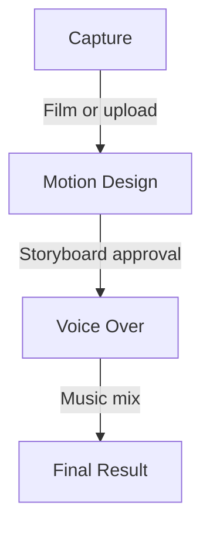

# Tutorial: your first narrated demo

You will make a short narrated demo of an app with Claude: a recording, a motion-design style you choose, a voice and background music. By the end you will know the four moves the plugin makes (**capture, motion, voice, music**) and the points where it stops to ask you.

## What you'll need

- The plugin installed ([README > Install](../README.md#install)).
- ED Narrator open (desktop app or `make up`), with `ffmpeg` working. Claude checks this in step 1.
- A folder Claude may read, set as `ED_NARRATOR_INPUT_DIRS` (for example `~/Movies/demo`). It must not be your home folder.
- Optional: a music file (`.mp3`, `.wav`, `.m4a`, `.aac`, `.ogg` or `.flac`) in that folder. The plugin never fetches music for you.
- Node, if you want Claude to record a browser or render animation. It asks before installing anything.

You do not need a script: Claude writes one from what is on screen.

## 🎯 The four-stage workflow

The plugin operates in four sequential stages. Understanding this order is key to successful demos:



- **Stage 1: Capture** – Get footage of your app (browser, screen, or existing film)
- **Stage 2: Motion** – Add animated style; Claude stops for your approval before rendering
- **Stage 3: Voice** – Write script, add narration with chosen voice, mix music
- **Stage 4: Result** – Receive final narrated video

## Step 1: Ask for the demo

Open Claude Code in your folder and type:

```
/ed-narrator-studio:studio a 40 second demo of the Models panel, English voice, 3D style, music in bed.mp3
```

Claude first calls `check_status`. A healthy answer says the app is reachable, shows its version, `ffmpeg_ok: true`, how many voices are available, and the input and output folders. If it says **No voice is available**, Claude offers to install one: see [How to install a voice](how-to.md#install-a-voice).

Then it asks one short brief (audience, length, capture mode, style, voice, music). Skip what you don't care about: it uses defaults (30 to 60 seconds, 16:9, the app's own colours).

## Step 2: Choose how to capture

Pick one:

- **Scripted browser capture.** You give a URL and the steps; Claude writes a small Playwright script and records it. Reproducible, and it needs no screen permission.
- **macOS screen recording.** You perform the demo; Claude starts `screencapture` after a 5-second warning. It needs Screen Recording permission for your terminal.
- **An existing film.** Claude copies it into the input folder and looks at a few frames.

Before it films, Claude asks you to close private windows. The screen may show customer data, names or keys, and everything on it ends up in the video.

When it finishes you get the film's path, length and size, and one line on what is on screen.

## Step 3: Approve the style

Claude proposes a style, with a recommendation, and publishes a **private animated storyboard** as an artifact: the shots as a timeline you can play, in the style it suggests.

| Style | What you get |
|---|---|
| **Editorial** (recommended for work tools) | your real recording with slow push-ins, understated lower-thirds and soft dissolves, in the app's own colours |
| **2D motion graphics** | animated title card, highlight rings, zoom callouts, end card |
| **Kinetic typography** | key lines animate as type, one scene per cue |
| **3D animation** | your recording on a 3D device or floating panel, camera moves |
| **Cinematic motion picture** | letterbox, slow push-ins, fades, grain, graded colour |
| **Minimal** | a short fade in and out |

**Claude stops here and waits.** Change the style, the colours or the intro length, or say "go". The pause is deliberate: a style you reject now costs seconds, and after rendering it costs minutes.

## Step 4: Watch the motion render

Claude renders the intro, callouts and outro (Remotion or ffmpeg) and joins them into one film. The film is silent on purpose and is saved in your input folder as `composed.mp4`. Claude tells you the intro length (say 3 seconds), because every line of the script starts after it.

## Step 5: Let it write the script, and fix the tight lines

Claude writes an `.srt` timed to the composed film and calls `preview_script`. The preview reports cues that are **too long for their slot**:

```
too_long_count: 1
advice: Shorten the listed cues or lengthen their slots.
```

Claude shows you those lines, shortens only them (keeping numbers and timings), and previews again until it reads `Every cue fits its slot.` It does not render with flagged lines unless you say so.

## Step 6: Voice it and add the music

Claude picks a voice for the language and tells you which, then calls `create_voiceover` with your music file. Progress is reported per cue. When the job is done it calls `download_result`.

## Step 7: Check the result

Claude reports the voice, how many lines were too long, whether music was used, and the saved path, for example `…/ed-narrator-output/1a2b3c4d-voiced.mp4`. Open it and listen.

If the music is too loud or too quiet, adjust it in the app: the **Music mix** panel has presets (Subtle, Balanced, Radio) and a ducking level. The plugin does not change the mix itself.

## What you learned

- Claude asks once, runs four stages, and **stops at the style approval**.
- Every input lives in your input folder; results go to the output folder.
- The voice replaces the film's own audio.
- Nothing was installed, published or deleted without your yes.

## Next

- Recipes for specific tasks: [How-to](how-to.md).
- Every tool, setting and limit: [Reference](reference.md).
- Why it is built this way: [Why a studio plugin](why-studio.md).
- Something went wrong: [Troubleshooting](troubleshooting.md).