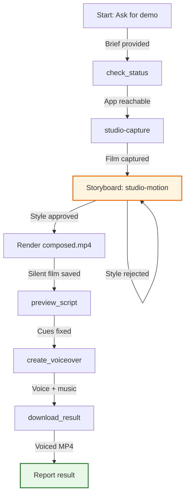
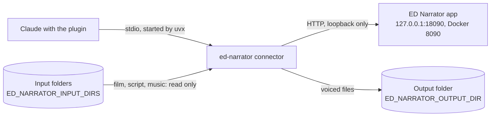

# Plugin Workflow Diagram

Here's a mermaid flowchart visualizing the ED Narrator Studio plugin's four-stage pipeline. This can be rendered in GitHub, GitLab, and many documentation viewers:

## How the plugin connects to the app

The connector reads only the listed input folders, writes only the output folder, and talks only to a loopback address. See [Security](docs/security.md).
